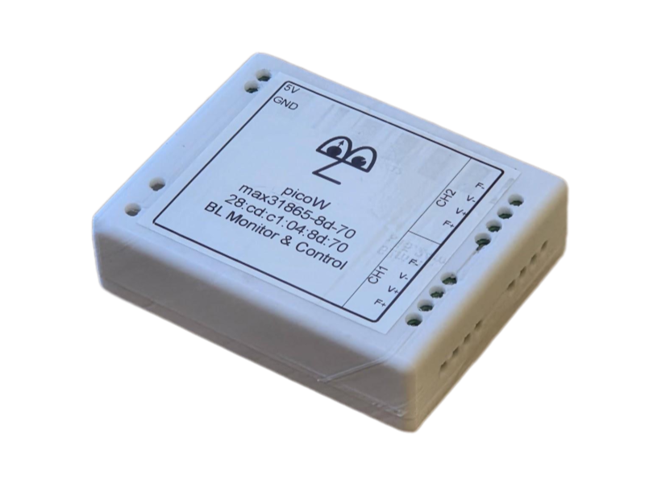
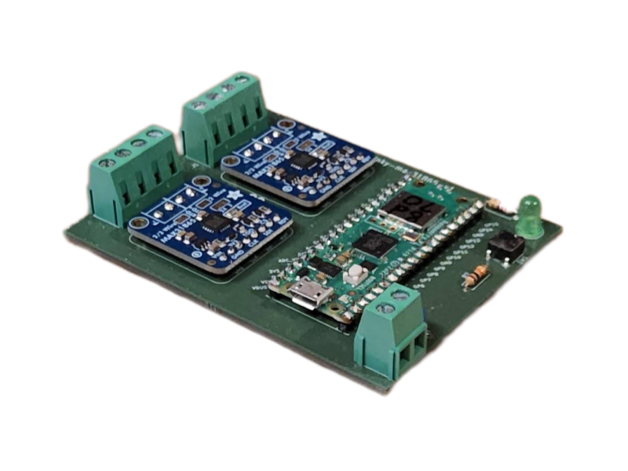

| Enclosure | PCB |
|-----------|-----|
|||

## Overview

The MAX31865 Cube is a compact, wireless instrumentation module in the Blinky-Lite Instrumentation Platform. It is designed to perform two precision four-terminal resistance measurements for temperature sensing, then communicate resistance and calculated temperature data to a central Blinky-Lite control system.

Four-terminal measurement removes the effect of lead resistance, which is necessary for precision resistance thermometry, including cryogenic applications. Each channel uses a MAX31865 resistance-to-digital converter with 15-bit resolution and resistance precision of 0.13 Ω.

For accurate temperature conversion across a wide operating range, each channel evaluates a seventh-order polynomial fit. Blinky-Lite downloads the coefficients to the cube and supports log-log, linear-linear, log-linear, and linear-log fitting modes.

Built around the Raspberry Pi Pico W / RP2040, the module uses 2.4 GHz Wi-Fi and MQTT publish/subscribe communication. This event-driven approach supports distributed deployments without wired data connections and enables Blinky-Lite to use device information for recording, notifications, visualisation, and machine-protection workflows.

### Key features

- Two precision resistance channels: Perform two independent four-terminal resistance measurements.
- Four-terminal temperature measurement: Minimise lead-resistance error for high-accuracy resistance thermometry, including cryogenic applications.
- High-resolution conversion: MAX31865-based measurement with 15-bit resolution and 0.13 Ω resistance precision.
- Flexible temperature characterisation: Use seventh-order polynomial fits downloaded from Blinky-Lite for accurate conversion from resistance to temperature.
- Four fit modes: Select log-log, linear-linear, log-linear, or linear-log characterisation for the sensor and operating range.
- Low-self-heating measurement: Pulse resistance measurements for 100 ms at a user-defined interval.
- Configurable noise reduction: Set the number of measurements averaged per reported value.
- Wireless connectivity: 2.4 GHz Wi-Fi for remote or distributed installations.
- Event-driven integration: MQTT publish/subscribe communication with Blinky-Lite.
- Open-source firmware: Microcontroller code can be adapted for site-specific instrumentation and integration requirements.

### Typical applications

- Cryogenic resistance thermometry
- Precision temperature monitoring using resistance sensors
- Laboratory and research instrumentation
- Distributed precision-sensor installations requiring central visibility
- Long-duration measurements where limiting sensor self-heating is important

## Getting started

### Hardware

1. Install the MAX31865 Cube close to the resistance sensors or equipment being monitored.
2. Connect each sensor using the specified four-terminal wiring arrangement and the 5 mm screw terminals for its channel.
3. Verify sensor type, lead configuration, resistance range, and environmental conditions before operation.
4. Power the device from a regulated 5 V DC supply through the 5 mm screw terminals.
5. Mount the enclosure on a DIN rail when required, or remove the DIN-rail mount for an alternative installation.

### Firmware build target

The firmware targets the Raspberry Pi Pico W / RP2040 using the Arduino-Pico board support.
- Board: Pico W / RP2040-compatible target
- Flash layout: Sketch 1920 KB, filesystem 128 KB
- FQBN flash option: flash=2097152_131072

### Open-source software and licensing

The firmware is released under the MIT License, giving users broad permission to study, modify, and adapt the code for their own applications. The open hardware design can likewise be customised to suit site-specific requirements. The firmware uses the open-source Arduino-BlinkyPicoW library, which is also available under the MIT License.

### Configuration

1. Build and upload the firmware using the project’s source and configuration files.
2. Use the onboard web interface to set or update Wi-Fi credentials.
3. Configure the MQTT connection and create the corresponding device integration in Blinky-Lite.
4. For each channel, select the appropriate polynomial-fit mode and download the seventh-order coefficients from Blinky-Lite.
5. Set the 100 ms measurement pulse interval to balance update rate against sensor self-heating.
6. Set the averaging count appropriate to the required noise performance and response time.
7. Verify resistance and calculated-temperature measurements against known references before operational use.

### Integration model

The MAX31865 Cube uses MQTT to publish resistance measurements, calculated temperatures, and alarm events. This event-driven model avoids conventional polling and enables prompt control-system responses to changing thermal conditions.
In a typical deployment, the device connects by Wi-Fi to the network and communicates through an MQTT broker. Blinky-Lite represents it as an integrated instrumentation node and can use its information for recording, display, notification, alarms, and machine-protection logic.

### Measurement, safety, and installation considerations

- Use four-terminal sensor wiring to minimise lead-resistance error.
- Choose the polynomial-fit mode and coefficients appropriate to the resistance sensor and operating range.
- Set the pulse interval and averaging count to balance self-heating, response time, and noise performance.
- Validate resistance and temperature conversion against known references before relying on the device for operational or protection decisions.
- Review sensor wiring, connector, cable routing, grounding, shielding, enclosure, and environmental requirements before installation.

