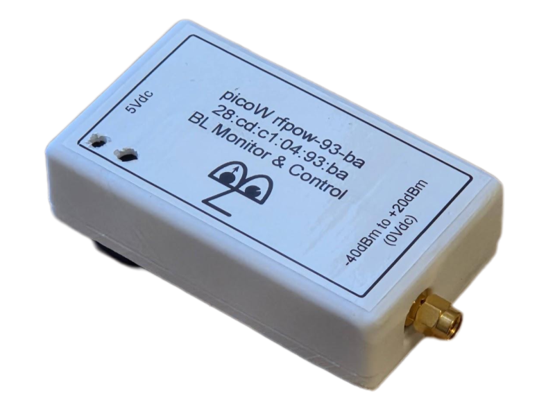
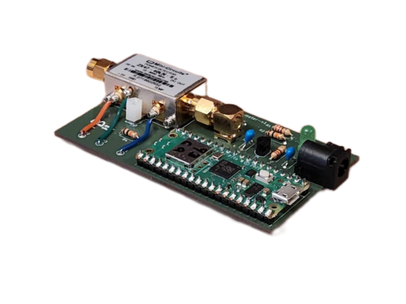

## Overview

The RF Power Meter Cube is a compact, wireless instrumentation module in the Blinky-Lite Instrumentation Platform. It is designed to measure RF power at or near the equipment being monitored, then communicate measurements and alarms to a central Blinky-Lite control system.

Built around the Raspberry Pi Pico W / RP2040, the module uses 2.4 GHz Wi-Fi and MQTT publish/subscribe communication. This event-driven approach supports distributed deployments without wired data connections and enables Blinky-Lite to use device information for recording, notifications, visualisation, and machine-protection workflows.

| Enclosure | PCB |
|-----------|-----|
||

### Key features

- Purpose-built function: Dedicated RF power measurement using the Mini-Circuits ZX47-40LN-S+ logarithmic RF power detector.
- Compact deployment: DIN Mod3-compatible enclosure with a removable DIN-rail mount for space-constrained installations.
- Wireless connectivity: 2.4 GHz Wi-Fi for remote or distributed installations.
- Event-driven integration: MQTT publish/subscribe communication with Blinky-Lite.
- Fast alarm and state reporting: RF power exceeding or falling below configured limits can be reported immediately.
- Configurable operation: Using the Blinky-Lite control system, calibration constants can be adjusted easily for each device and its particular frequency band.
- Open-source firmware: Microcontroller code can be adapted for site-specific instrumentation and integration requirements.

### Typical applications

- RF system commissioning and troubleshooting
- Continuous RF power monitoring at remote equipment locations
- Accelerator, laboratory, and industrial test systems
- Distributed instrumentation installations requiring central visibility
- RF alarm and machine-protection workflows



## Getting started

### Hardware

1. Install the RF Power Meter Cube near the RF point to be monitored.
2. Connect the RF signal to the SMA input, ensuring the expected input level and frequency remain within the supported measurement range.
3. Verify that the RF source, connector, cabling, and installation conditions are suitable for the application.
4. Power the device from a regulated 5 V DC supply through the 2.1 mm barrel connector.
5. Mount the enclosure on a DIN rail when required, or remove the DIN-rail mount for an alternative installation.

### Firmware build target

The firmware targets the Raspberry Pi Pico W / RP2040 using the Arduino-Pico board support.
- Board: Pico W / RP2040-compatible target
- Flash layout: Sketch 1920 KB, filesystem 128 KB
- FQBN flash option: flash=2097152_131072

### Open-source software and licensing

The firmware is released under the MIT License, giving users broad permission to study, modify, and adapt the code for their own applications. The open hardware design can likewise be customised to suit site-specific requirements. The firmware uses the open-source Arduino-BlinkyPicoW library, which is also available under the MIT License.

### Configuration

1. Build and upload the firmware using the project’s source and configuration files.
2. Use the onboard web interface to set or update Wi-Fi credentials.
3. Configure the MQTT connection and create the corresponding device integration in Blinky-Lite.
4. Set calibration data and measurement limits appropriate to the RF detector, operating frequency, and required accuracy.
5. Verify that normal measurements and alarm events appear as expected in Blinky-Lite.

### Integration model

The RF Power Meter Cube uses MQTT to publish measurements and alarm events. This event-driven model avoids conventional polling and enables prompt control-system responses to changing RF conditions.

In a typical deployment, the device connects by Wi-Fi to the network and communicates through an MQTT broker. Blinky-Lite represents it as an integrated instrumentation node and can use its information for recording, display, notification, alarms, and machine-protection logic.

### Measurement, safety, and installation considerations

- Confirm that connected RF signals and environmental conditions are within the product’s specified limits.
- Apply calibration and measurement limits appropriate to the intended frequency band and required accuracy.
- Validate normal operation and alarm behaviour against a known reference source before relying on the device for operational or protection decisions.
- Review connector, cable, grounding, shielding, enclosure, and environmental requirements before installation.
- Do not exceed the supported RF input range.
